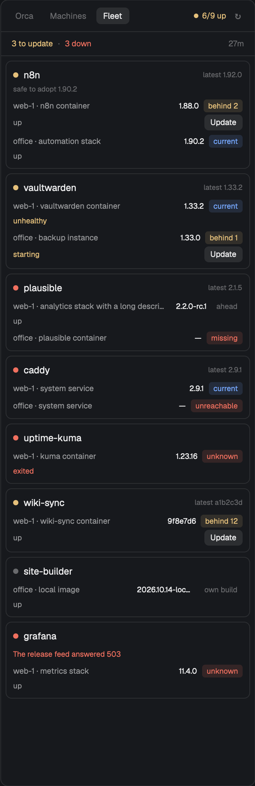

# Orca Status

A panel that docks on the right of the window and answers three questions from three tabs: what are my Orca agents doing (Orca), how are my machines holding up (Machines), and which of the services I host need updating or have gone down (Fleet). It only reads, except for the Fleet tab's Update button, which asks first and then hands the job to an agent in a new tab.



## What you see

The panel is 340 px wide and fills its block's height, with 10 px rounded corners, a 1 px `border`, `background` behind it and 13 px base text. Colours are all `theme()` names. Top to bottom:

**Header, every tab.** 42 px tall, 10 px side padding, a 1 px line under it. On the left, three pills, Orca, Machines and Fleet: 22 px tall, 9 px side padding, 6 px corners, 11 px text. The active pill is `raised` with `foreground` medium text; the others are `dim`. On the right, a health readout (6 px dot and 10.5 px text, both in the same colour) and a 24 px square refresh button showing `↻` in `dim`, or a 12 px spinner in `working` while its tab is loading.

The health readout depends on the tab:

| Tab | Text | Colour |
|---|---|---|
| Orca | `ready` | `done` |
| Orca | the runtime's state, `offline` or `starting` | `working` |
| Orca | `status unknown` | `working` |
| Orca | `unreachable` (last load failed) | `blocked` |
| Machines | `N/M online` | `done` all, `working` some, `blocked` none |
| Fleet | `N/M up` | `done` all, `working` some, `blocked` none, `dim` when M is 0 |
| Fleet | `no census` (no snapshot yet) | `dim` |

**Orca tab.**
- With no data yet: a 20 px spinner and `Reading Orca…`, or the error in `blocked` with a Retry button.
- A failed refresh with data on screen: a banner tinted `blocked` at 18 hex alpha, with `!`, the error truncated to one line and a Retry link.
- A strip, 10.5 px `dim`: `v<version> · runtime ready · graph ready`, and how long ago it loaded on the right. A graph that isn't ready shows in `blocked`.
- A counter row: working, waiting, blocked on the left, done on the right, each a dot and `N label`. A zero count is `dim`.
- Three folding sections with uppercase 10.5 px headers and a chevron:
  - **Agents:** active agents, most urgent first, then `RECENTLY DONE`, four shown. Each row has a title (task, else prompt), an agent-type chip, the workspace name and an age.
  - **Runs:** the 8 most recent orchestration runs, newest first. Each has a chevron, objective, state chip (`N issues`, `complete`, `running`, `no tasks`), a 3 px progress bar in the chip's colour, `finished/total` and an age. `N decisions waiting` shows in `accent` when gates are pending.
  - **Workspaces:** those with a live terminal, active or unread; six shown. Each has a 5 px status dot, a name with a 5 px `accent` dot if unread, `branch · status`, `N live` or `idle`, and an age.

**Machines tab.**
- A strip: `N spaces · N agents`, then `N working` in `working` and `N needs you` in medium `blocked` when above zero, and how long ago it sampled on the right.
- One card per connected machine, this computer first (`This Mac`, `This PC` or `This machine`), the rest by name. Cards are `mx(6).mb(6).px(9).py(8)`, 8 px corners, `surface` with a `border` outline.
- A live card has a dot in `done`, the name at 12.5 px medium, and uptime on the right. Below that: CPU (`working`), MEM (`accent`) and DISK (`done`) bars 5 px tall, which turn `blocked` at 90% or more. Then a 30-slot CPU history strip 15 px tall, newest on the right, with `load x · Nc` beside it. Then `TOP PROCESSES` with three rows and their CPU, `working` at 25% or more. Last, `N spaces · N agents` and the working and needs-you counts.
- An unavailable machine has a `dim` dot, `offline` and `Herdr can't reach this machine's core.` A failed sample has a `blocked` dot, `failed`, the error and a tinted border. A machine not sampled yet has a spinner and `Reading CPU, memory and disk…`.

**Fleet tab.**
- Without a `fleet.json`: `No fleet.json yet` and `Copy mods/orca-status/fleet.example.json to fleet.json in the same folder, then point census at your own command.`, centred.
- With no snapshot while the census runs: a 20 px spinner and `Reading the fleet…`.
- With no snapshot after a failure, including invalid JSON or a missing census: the error in `blocked` on one truncated line, with the full text in a tooltip, and a Retry button, centred.
- With a snapshot:
  - After a failed run, the same banner as the Orca tab.
  - A strip: `N to update` (`working` above zero, else `dim`), `· N down` in medium `blocked` only when above zero, and how long ago the census ran on the right.
  - One card per app in the census's order, with the same frame as the Machines cards.

An app card:
- **Head row:** a 7 px dot, the name at 12.5 px medium, and `latest <newest>` at 9.5 px `dim` on the right, left out when `newest` is null. The dot takes the worst of the card: `blocked` for an app error, a blocked status or a stopped service; then `working` for `behind N`, `unhealthy` or `starting`; then `done` for `current`; else `dim`.
- **`safe to adopt <safe>`:** a 9.5 px `dim` line, only when `safe` is set and differs from `newest`.
- **App error:** a 10 px `blocked` line.
- **One block per install.** First row: `host_label · where` at 10.5 px `muted`, truncated; the installed version at 10 px `foreground`, at most 78 px wide and truncated, `—` when null; then a status chip, at most 96 px wide and truncated. Second row, only when there is something to put in it: the running state on the left at 10 px, at most 170 px wide and truncated, and an Update button on the right.

| Status chip | Colour | Tinted background |
|---|---|---|
| `current` | `done` | yes |
| `ahead`, `own build` | `dim` | no |
| `behind N` | `working` | yes |
| `missing`, `unreachable`, `unknown` | `blocked` | yes |

| Running state | Shows | Colour |
|---|---|---|
| `state` running, health healthy, none or absent | `up` | `muted` |
| `state` running, health unhealthy | `unhealthy` | `working` |
| `state` running, health starting | `starting` | `working` |
| anything else | the `state` word | `blocked` |
| `running` null or absent | nothing | |

## How it behaves

**Agent statuses, Orca tab** (states reported by Orca):
- `working`: a 12 px spinner in `working`, turning every 900 ms.
- `blocked`: an 11 px tile tinted `blocked` with a bold `!`, the row tinted `blocked` at 12 hex alpha, and `needs you` in medium `blocked`.
- `waiting`: a 7 px ring in `accent`.
- `done`: a 7 px `done` dot and a `muted` title, listed under `RECENTLY DONE`. An agent reporting no state counts as done.
- Any other state, such as `idle`: a 7 px dot in that theme colour, or `dim` if the theme has none, listed with the active agents.

**Agent statuses, Machines tab** (Herdr's own `agents()`): `working` and `blocked` appear as the `N working` and `N needs you` counts. `done` and `idle` count only towards `N agents`.

**Clicks**
- A pill switches tab. The tab is remembered in shared state as `orca-status.view` and restored on the next start; any other saved value opens Orca.
- Refresh runs the shown tab's load now.
- Orca tab: a section header folds it. An agent row opens `PROMPT`, `LAST MESSAGE` (up to 900 characters), `TOOL` and `PATH`. A run row opens its objective and its tasks, sorted blocked, failed, dispatched, ready, pending, completed. `Show all N` and `Show fewer` expand and collapse the done agents and the workspaces. Retry loads again.
- Fleet tab: Retry runs the census again. Update opens the shipped `confirm` dialog: title `Update <app> on <host_label>?`, detail `<installed> → <safe>. Opens a <agent> tab with this brief; nothing changes until you approve it there.` Cancel or Esc closes it and changes nothing. Confirm or Enter opens a tab named `update <app>` in the configured folder, running the configured agent, with the filled-in task as its first message.
- The Update button shows only on an install whose status starts with `behind`, when the app has a `safe` version and `fleet.json` has an `update` with a `task` and an `argv` that is a non-empty list of non-empty strings. Any other `argv` means no button.

**Keys.** `cmd-shift-m` runs `orca-status.toggle`, which cycles Orca → Machines → Fleet → Orca. In the Update dialog, Enter confirms and Esc cancels.

**Hovers.** Pills, refresh, agent rows, run rows and the Update button brighten to `hover`. Section headers and `Show all` / `Show fewer` turn their text `foreground`. After half a second, tooltips show:
- Pills: `Orca agents, runs and workspaces`, `CPU, memory and disk of every machine`, `Each service you host: installed version, latest version and status`.
- Refresh: `Refresh now`.
- Agent and run rows: `Show details` / `Hide details`, `Show tasks` / `Hide tasks`.
- Fleet: full app name, place, version, `latest` and `safe` value; the app error and both kinds of tab error in full; on a status chip, its `reason`, or the status itself when there is none; on the running state, the census's `status` text (`Up 8 days`), or the word shown when there is none.

**What moves.** Spinners turn natively. Nothing else animates.

**When it loads**
- Orca: every 15 s while Orca is showing, and on opening it if older than that.
- Machines: every 5 s while Machines is showing, and on opening it if older than that.
- Fleet: never on those timers. A timer checks once a minute and runs the census only while Fleet is showing and the last attempt is older than `refresh_minutes` (default 15). The same timer redraws the tab while it's showing, so the age on the strip stays current. Opening the tab with no snapshot or a stale one runs it once. Refresh and Retry run it now. Never two at once.
- While the census reruns, the snapshot stays on screen with the header spinner. A failed run keeps the last snapshot and shows the banner.

**Numbers in the Fleet tab**
- `N to update` counts installs whose status starts with `behind`.
- `N/M up`: M is installs with a `running` object, N is those showing `up`.
- `N down` is M minus N, so `unhealthy` and `starting` count as down.
- The time on the right comes from the census's `generated_at`, or from when the run finished if that's missing or unreadable.

## Built from

**Files**

```
keys.json                        { "global": { "cmd-shift-m": "orca-status.toggle" } }
mods/orca-status/main.js         the mod, one View
mods/orca-status/mod.json        { "place": "right", "size": 340 }
mods/orca-status/spinner.svg     ring spinner
mods/orca-status/chevron-down.svg, chevron-right.svg
mods/orca-status/fleet.example.json
mods/orca-status/census.sample.json
```

The mod takes no `props`. It uses the shipped `confirm` mod through `openOverlay({ mod: "confirm", kind: "dialog", width: 380, height: 190, props: { title, detail, command } })`.

**`herdr` functions:** `exec`, `theme`, `machines`, `spaces`, `agents`, `window`, `shared`, `setShared`, `nextCommand`, `appHome`, `readTextFile`, `openOverlay`. **`gpui-kit`:** `View`, `div`, `svg`. **`gpui-base`:** `v_flex`, `h_flex`.

**Command:** the only one is `tab.new { name, folder, argv, task }`, run by `confirm`.

**Programs**
- `orca status --json`, `orca worktree ps --limit 100 --agent-wait --json`, `orca orchestration run-list --limit 8 --json`, `orca orchestration task-list --run <id> --brief --json`, and `orca orchestration gate-list --run <id> --json` for runs with unfinished tasks.
- `sh -c <script>` on each connected machine (`exec` with `on: machine.name`), for Linux and macOS: `uname`, `getconf`, `sysctl`, `vm_stat`, `iostat`, `/proc`, `df`, `ps`, `awk`. It prints `key=value` lines and `proc\t<cpu>\t<mem>\t<name>` lines. Machines whose layout is `unavailable` are skipped.
- The census: `exec(argv[0], argv.slice(1), { cwd })`, here only.

**`mods/orca-status/fleet.json`** is the person's own, optional and git-ignored. It is read with `readTextFile` from `appHome()` at the start of every census run. An empty `cwd` or `folder` means `appHome()`. `{app} {host} {where} {installed} {target}` are filled in `task` in one pass, where `{host}` is `host_label` and `{target}` is `safe`. `fleet.example.json`:

```json
{
  "census": { "argv": ["cat", "mods/orca-status/census.sample.json"], "cwd": "" },
  "refresh_minutes": 15,
  "update": {
    "argv": ["claude"],
    "folder": "",
    "task": "Update {app} on {host} ({where}) from {installed} to {target}. Ask me before you run anything that changes the machine."
  }
}
```

**Census contract.** Any command that prints this JSON on stdout and exits 0:

```
{ "generated_at": "...", "apps": [ {
    "name": "n8n", "safe": "1.90.2" | null, "newest": "1.92.0" | null,
    "error": null, "note": null,
    "installs": [ {
      "host": "web", "host_label": "web-1", "where": "n8n container",
      "installed": "1.88.0",
      "status": "current" | "ahead" | "behind N" | "own build" | "missing" | "unreachable" | "unknown",
      "reason": null | "text",
      "running": null | { "container": "...", "state": "running", "health": "healthy" | "unhealthy" | "starting" | "none", "status": "Up 8 days" }
    } ] } ] }
```

`behind N` must be measured against `safe`, because Update targets `safe`. A census measuring against `newest` could offer `1.90.2 → 1.90.2` or a downgrade.

A missing `running` is treated like `null`. Other fields (`hosts`, `cloudflare`, `command`, `note`) are dropped when the census is read, so none of them are ever shown. A missing `host_label` falls back to `host`.

## Watch out

**What it runs and opens**
- It runs `orca` here and `sh` on every connected machine, and it runs whatever command `census.argv` names. Nothing else.
- It opens agent tabs, but only after someone confirms the dialog.
- The Update button hands over to an agent and never updates anything itself. Whether the agent asks before changing anything comes from the task text in `fleet.json`.

**What it assumes**
- The Orca tab needs the Orca CLI (`orca`) on this computer.
- The Machines tab needs `sh` on each machine.

**Limits to plan for**
- **Census time limit:** Herdr's `exec` stops any program after 30 s and caps output at 8 MiB. A census that runs longer always fails with `` `herdr.exec`: <program> took longer than 30 s and was stopped `` in the tab, naming whichever program ran. The tested way round it: the census command prints its last saved JSON at once and refreshes that file in the background, so `generated_at` shows the data's real age. With no saved file yet, it should exit non-zero with a clear message, so the tab shows that message and Retry.
- **A hidden panel keeps running the census.** Timers run while a mod is hidden, so a panel left on Fleet still runs the census every `refresh_minutes`.
- **Agent trust prompt:** an empty `update.folder` means the app's home folder. Claude Code shows its trust prompt there the first time, before the task reaches it. Set `folder` to a trusted one to skip that.
- **Saving `fleet.json` reloads the mod,** because it sits in the mod's folder. The snapshot is held in memory, so the census runs again if Fleet is showing.
- **Failed runs:** staleness counts from the last attempt, successful or not, so a failing census waits for `refresh_minutes` instead of rerunning every minute. Retry skips the wait.

**Sizes**
- **Width:** checked at 340 and 280 px: the Fleet tab doesn't overflow, and all three headers fit with the readouts `ready`, `N/M online` and `N/M up`. A layout can set its own minimum for this block, which `layout.resize` won't go below.
- **Confirm dialog:** no shipped mod opens `confirm` with `openOverlay`, so there is no size to copy. 380 × 190 fits the two-sentence detail; a longer one scrolls inside the dialog.

**Files and sample data**
- The preview uses sample data from `census.sample.json`. Its `generated_at` is fixed, so with the sample the time on the right only grows.
- The two files a person edits are their own `fleet.json` and their `keys.json`. Merge this repo's `keys.json` into theirs and ask before replacing a key they already use.
- `.d.ts` files and `jsconfig.json` in the mod folder are written by the app and are not part of the mod.

**Building it**
- `<mod>.<command>` reaches every shown copy of a mod, so a second open copy also reacts to `orca-status.toggle`.
- Tooltips go on a plain `div`, `h_flex` or `v_flex`, each with its own `.id()`.
- Long versions, places, statuses, running states and errors need `min_w(0)` or `max_w` with `truncate()`, or they push controls out of the card. The chip keeps its look by truncating a `div` inside it.
- `shot` returns the last frame and hot reload can lag by a few seconds, so look again before believing an old picture.

## Done when

- `herdr-app check mods/orca-status` passes and `herdr-app status` shows `errors: []`.
- All three pills show and switch, and `orca-status.toggle` cycles Orca → Machines → Fleet → Orca. The chosen tab survives a reload.
- Orca lists agents, runs and workspaces from `orca`; rows open and sections fold.
- Machines shows one card per connected machine, with bars and a history strip that fills every 5 s.
- Without `fleet.json`, Fleet shows the setup message and runs nothing, and the header says `no census`.
- A broken `fleet.json`, or one with no `census`, shows that error in the tab with Retry, and the other two tabs still work.
- With `fleet.example.json` copied to `fleet.json` and the sample census, the header shows `6/9 up`, the strip shows `3 to update · 3 down`, and eight cards appear in the sample's order.
- Every chip and running colour matches the tables above at 340 and 280 px, and nothing overflows. Long values truncate, with the full value in a tooltip.
- Update appears on the three `behind` rows only. On n8n at web-1 the dialog says `Update n8n on web-1?` and `1.88.0 → 1.90.2. …`.
- Cancel changes nothing. Confirm opens one tab named `update n8n` whose first message is `Update n8n on web-1 (n8n container) from 1.88.0 to 1.90.2. Ask me before you run anything that changes the machine.`
- With `update.argv` set to `[5]` or `[{"toString":1}]`, every card still draws and no Update button appears.
- A census that exits non-zero after a good run keeps the cards and shows the banner, `Census exited 3: …`, with Retry.
- A census that runs for 40 s ends in the 30 s error rather than a hung spinner.
- The sample's `command` field never shows anywhere in the tab.
